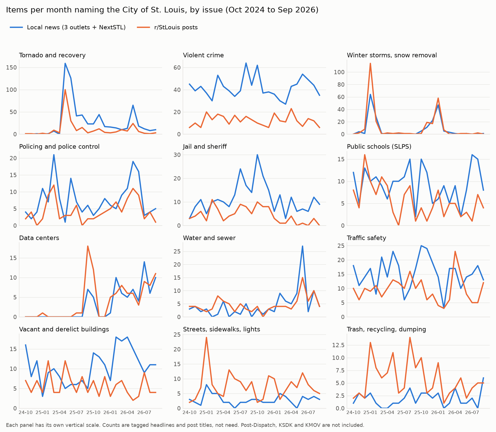
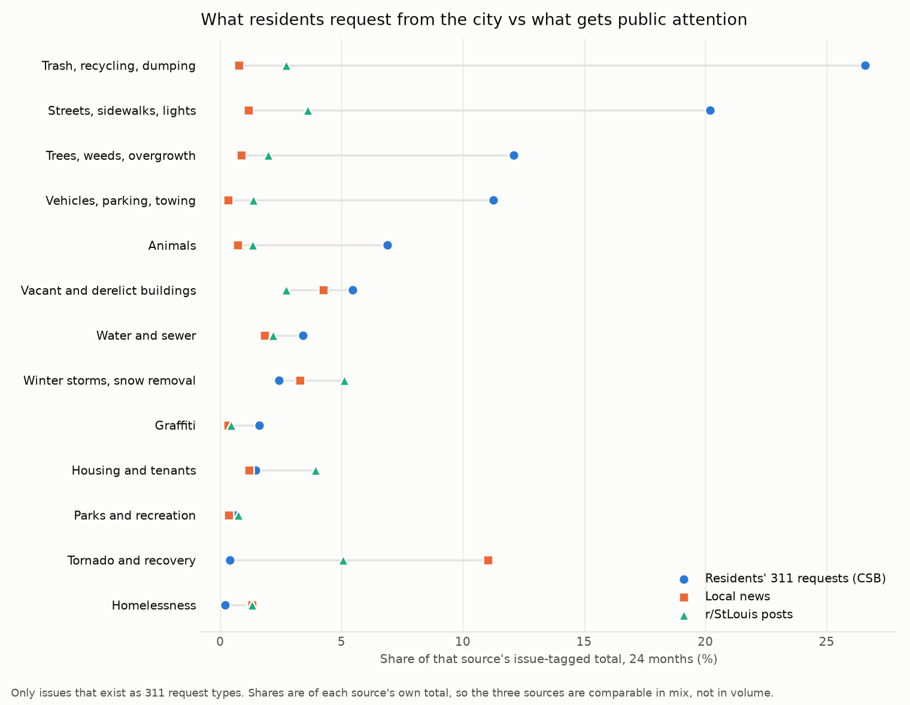
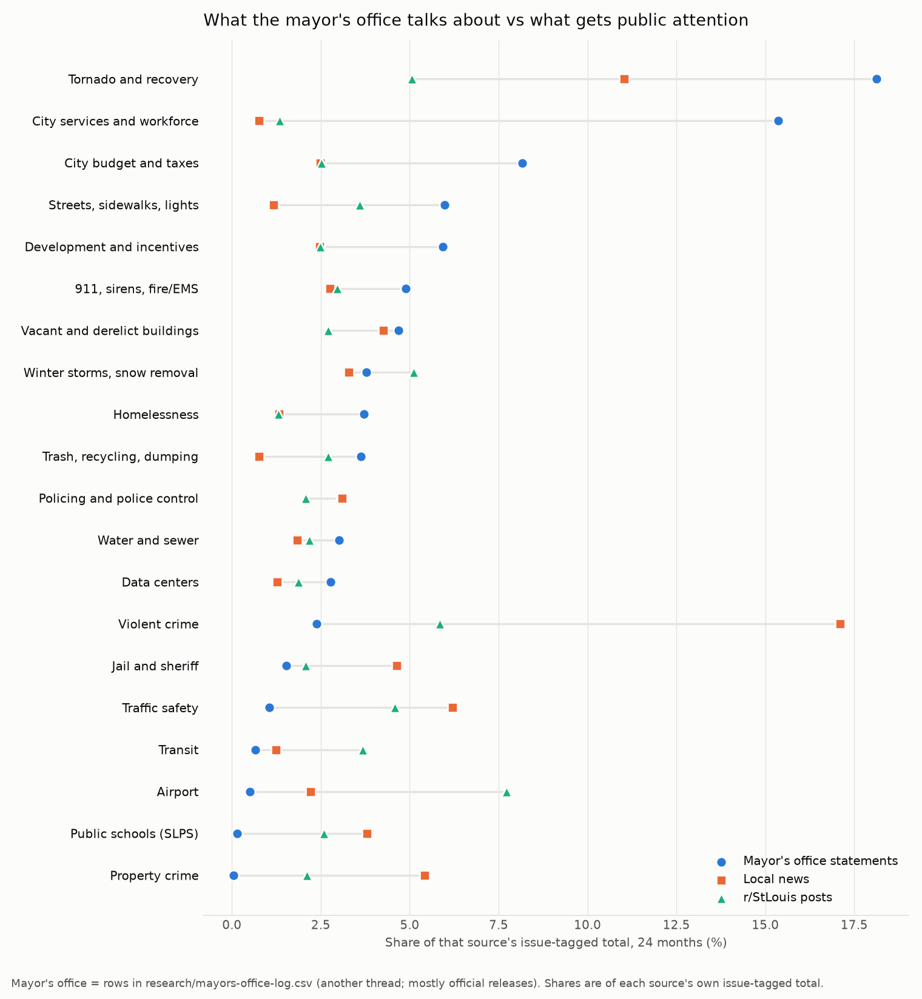

# D. Public attention to city problems, over time

Collection ran 2026-10-13 23:21–23:42 UTC.

**Mentions measure attention, not need.** A count here says how often an issue appeared in a headline, a forum post title or a bill title. It says nothing about how many people are affected or how severe the problem is. Nothing in this file is a solution or a project idea.

Labels: **observed** = this thread checked it directly; **reported** = a source says so; **inferred** = this thread's conclusion.

## Summary

**Found.**

- 85,706 dated items from six sources, 2024-10-01 to 2026-10-13: Fox 2, St. Louis American, St. Louis Public Radio (STLPR), NextSTL, r/StLouis and Board of Aldermen bills. 34 issue categories were derived from the material. 9,662 items carry an issue tag and name the city; the counts below use only those. (**observed**)
- The three records disagree most on routine services. Trash, streets and lights, trees and weeds, and vehicles and towing are 70% of residents' 311 requests. Each takes 0.3–1.2% of news issue tags and 1.4–3.6% of r/StLouis issue tags, in every outlet. (**observed**)
- News attention goes to violent crime (17.1%) and the tornado (11.0%). The crime figure is a Fox 2 effect: 968 of the 1,010 items are Fox 2's. STLPR and the St. Louis American lead with tornado recovery (20.1% and 17.2%). (**observed**)
- The mayor's-office log leads with tornado recovery (18.1%) and city services and workforce (15.4%). It has little on violent crime (2.4%), traffic safety (1.1%), schools (0.2%) or property crime (0.0%). (**observed**, using an unfinished local file)
- Requests and attention move together month to month for one issue only: winter storms (r = 0.90 with news, 0.97 with Reddit). Every large spike traces to a dated event; a few small Reddit spikes have no single cause. (**observed** counts; causes **inferred** from headlines)

**Could not establish.**

- The Post-Dispatch, KSDK and KMOV are missing. Their feeds blocked the pull or hold no archive. Television is Fox 2 alone, and Fox 2 is 74% of the news issue tags.
- Nothing from Nextdoor, Facebook groups, public-meeting testimony or letters to the editor.
- Tagging is approximate: about 0.80 precision and 0.67–0.79 recall on random items. Issue-month counts below about 20 should not be read closely. The kind of mention (complaint, incident and so on) was right only 53–66% of the time. Tone was not scored.
- The hand-check labels were assigned by this agent, the same reader that wrote the rules. No second reader checked them.

**Two caveats.** The r/StLouis rows come from Arctic Shift, a third-party archive that publishes no usage terms; they are a separate source and can be dropped. Filling the Post-Dispatch gap needs either a slower pull (days, at the rate their feed allows) or a licensed index.

## 1. Sources and their limits

Window: 2024-10-01 to 2026-10-13. Nothing was logged in to; no account was made; no article body was stored. Collector: `scripts/attention/collect.py`. Raw pulls: `data/raw/attention/<source>/items.jsonl` with a `manifest.json` each. Probe responses: `data/raw/attention/_probes/`. All rows in this section are **observed** unless marked.

### Collected

| Source | URL and method | Retrieved (UTC, 13 Oct) | Rows pulled → kept | Date range |
|---|---|---|---|---|
| Fox 2 (KTVI) | <https://fox2now.com/wp-json/wp/v2/posts>, categories Missouri, FOX Files, You Paid For It; 156 requests | 23:26:49–23:31:38 | 15,553 → 15,549 | 2024-10-01 to 2026-10-13 |
| St. Louis American | <https://www.stlamerican.com/wp-json/wp/v2/posts>; 43 requests | 23:26:49–23:28:18 | 4,283 → 4,201 | 2024-10-01 to 2026-10-13 |
| St. Louis Public Radio | Monthly sitemaps from <https://www.stlpr.org/sitemap.xml>; 25 requests | 23:26:49–23:27:07 | 18,184 → 4,290 | 2024-10-01 to 2026-10-12 |
| NextSTL | <https://nextstl.com/wp-json/wp/v2/posts>; 1 request | 23:26:49–23:26:50 | 34 → 34 | 2024-10-01 to 2026-05-20 |
| r/StLouis | Arctic Shift archive, <https://arctic-shift.photon-reddit.com/api/posts/search?subreddit=StLouis>; 331 requests | 23:26:49–23:41:42 | 62,690 → 61,297 | 2024-10-01 to 2026-10-13 |
| Board of Aldermen bills | <https://www.stlouis-mo.gov/government/city-laws/board-bills/index.cfm> plus each bill page; 440 requests, 0 errors | 23:26:49–23:33:43 | 437 → 335 | 2024-04-26 to 2026-10-09 pulled; 335 fall in the window |

Coverage is even across the window: Fox 2 has 579–718 items a month, the American 111–204, STLPR 155–209 local items, r/StLouis 1,998–3,357 posts. NextSTL has six empty months.

### Coverage, gaps and likely bias

- **Fox 2.** The "Missouri" category is statewide and metro-wide. The tagger found a city reference in 39% of its items (6,071 of 15,549). It is a television newsroom: 22.0% of its city issue tags are violent crime, 7.9% traffic safety (mostly crashes) and 7.2% property crime. It supplies 968 of 1,010 violent-crime items, 318 of 320 property-crime items and 349 of 366 traffic-safety items. (**observed**) Reading "news" as "Fox 2" is safer than reading it as "the press". (**inferred**)
- **St. Louis American.** All sections were pulled, including national entertainment and editorials. Its city issue tags lean to tornado recovery (17.2%), downtown (12.7%), schools (7.7%) and development (7.7%). (**observed**)
- **STLPR.** Titles are rebuilt from URL slugs, so they lack punctuation and can differ from the published headline; there is no snippet. 13,894 rows in non-local sections (almost all `npr`) were dropped. Its city issue tags lean to tornado recovery (20.1%), the jail and sheriff (12.1%) and schools (8.2%). (**observed**)
- **NextSTL.** 34 items in two years, none after May 2026. Too small to carry a finding.
- **r/StLouis.** Metro-wide and self-selected. 40,171 of 61,297 posts have no flair; the largest flairs are Ask STL (8,071), Things to Do (2,579) and News (1,888). Much of it is recommendations, events and travel questions. 7,064 kept posts have removed or deleted bodies, so only the title is tagged. Median 6 comments a post. Who posts there is not known. The data come from a third-party archive, so completeness against Reddit itself could not be checked.
- **Board bills.** Bills only. No hearings, testimony, resolutions or committee minutes. A bill title shows what aldermen moved on, not what residents raised.
- **Across outlets.** The same event covered by three outlets counts three times. That is intended: it is what volume of attention means here.

### Tried and not usable (negative results)

| Source | What happened |
|---|---|
| Post-Dispatch search feed, <https://www.stltoday.com/search/?f=rss&t=article&c[]=news/local*> | Returns title, one-line description, date and link. HTTP 429 after about 20 requests, then blocked for more than 20 minutes. Three runs with slower pacing, last block at 00:13 UTC on 14 October. 0 rows kept. Opinion and letters (`c[]=opinion*`) were never reached. |
| Post-Dispatch search feed, JSON form | Returns full article bodies. Not used; the one probe file was deleted. |
| Post-Dispatch sitemap, <https://www.stltoday.com/tncms/sitemap/editorial.xml?year=2026> | URL and date only. URLs are IDs with no words, so no headline. |
| GDELT DOC 2.0, <https://api.gdeltproject.org/api/v2/doc/doc>, `domain:ksdk.com "st. louis"` | HTTP 429 on almost every request. 3 of 7 weekly windows returned (30, 30 and 32 articles) in about 30 minutes; stopped at 23:59 UTC. 0 rows kept. KMOV was never reached. |
| KSDK own site, <https://www.ksdk.com/sitemap.xml> | Sections only; the news sitemap holds 156 recent URLs. No archive. |
| KMOV / First Alert 4, <https://www.firstalert4.com/arc/outboundfeeds/sitemap-index/?outputType=xml> | About 470 URLs, roughly one week. No archive. |
| reddit.com | `/r/StLouis/new.json` returns HTTP 403; RSS gives only the latest posts. |
| Missouri Independent WordPress API | HTTP 403. |
| Bluesky public search | HTTP 403. |
| St. Louis Magazine | Sitemap exists; not pulled. |
| Google News RSS | Needs preset keywords, which step 3 rules out. Not used. |
| Nextdoor, Facebook groups | Need a login. Not attempted. |

## 2. Collection and de-duplication

`scripts/attention/merge.py` writes `data/raw/attention/_derived/items.jsonl` and a drop report (`items_report.json`). It drops out-of-window rows (102 bills), non-local STLPR sections (13,894), repeated ids, and items from the same outlet with the same normalised title in the same month (Fox 2 4, American 82, Reddit 1,393). Bills are exempt from the title rule because separate bills share short titles. Result: 85,706 items — 24,074 news, 61,297 forum posts, 335 bills. (**observed**)

Stored per item: source, date, title, snippet of at most 240 characters, URL, section; score and comment count for Reddit.

## 3. Issue categories and how they were derived

No list was fixed in advance. (**observed**, method)

1. Two topic-model passes on titles (TF-IDF then NMF): 45 topics on news and 50 on Reddit, then 60 on the 23,172 items that named the city or a civic term. Scripts: `scripts/attention/topics.py`, `topics_city.py`.
2. The top terms and sample titles of each topic were read. Topics about one kind of city problem became a category; topics about sports, weather forecasts, restaurants, events and national politics were left untagged.
3. Each category was written as a transparent keyword rule (an include pattern and an exclude pattern) in `scripts/attention/tag.py`. An item can carry several tags; 16% of tagged city items do.
4. Items with no issue tag but a city-government term (mayor, aldermen, City Hall, election) go to a residual, `city_government_general`.

Each item also gets a **scope**: `city` if it names the City of St. Louis, a city institution or a city neighbourhood; `elsewhere` if it names another jurisdiction and not the city; `unstated` otherwise. News: 9,066 city, 8,113 unstated, 6,895 elsewhere. Reddit: 18,924 city, 36,537 unstated, 5,836 elsewhere. Tagged and city-named: 4,945 news items, 4,448 Reddit posts, 269 bills.

Each item also gets a **kind of mention** (incident, complaint, announcement, praise, other) from ordered keyword rules.

### The categories, with 24-month counts

Counts are for the 24 full months, October 2024 to September 2026, city-named items. "311" is Citizens' Service Bureau requests mapped by this thread (section 6). "Mayor" is rows in `research/mayors-office-log.csv` mapped by this thread (section 7). "Check" is the share of four sampled items per category whose tag was right (sample B, section 4).

| Category | What the rule catches | News | r/StLouis | Bills | 311 | Mayor | Check |
|---|---|---:|---:|---:|---:|---:|---|
| violent_crime | shootings, homicides, carjackings, crime statistics | 1,010 | 295 | 0 | – | 61 | 4/4 |
| tornado_recovery | tornado, FEMA, storm debris, disaster relief | 651 | 256 | 6 | 1,044 | 464 | 4/4 |
| traffic_safety | pedestrians, cyclists, hit-and-run, speed humps, reckless driving | 366 | 232 | 62 | – | 27 | 3/4 |
| property_crime | theft, burglary, car break-ins, stolen cars | 320 | 107 | 0 | – | 1 | 4/4 |
| city_government_general | residual: mayor, aldermen, elections, no issue | 278 | 254 | 34 | – | – | 2/4 |
| jail_sheriff | sheriff, City Justice Center, detainees | 274 | 105 | 4 | – | 39 | 3/4 |
| vacant_derelict_buildings | vacant, blight, demolition, condemned, LRA | 251 | 137 | 19 | 13,846 | 120 | 3/4 |
| downtown | downtown with vacancy, safety, closures, plans | 245 | 383 | 2 | – | 35 | 3/4 |
| schools_slps | SLPS, closures, superintendent, school board | 224 | 131 | 0 | – | 4 | 4/4 |
| winter_storm_snow_removal | snow, ice, ploughs, side streets | 194 | 258 | 0 | 6,163 | 97 | 2/4 |
| policing | state control, police board, chief, budget, staffing | 183 | 105 | 1 | – | 79 | 3/4 |
| fires | fires, arson | 166 | 157 | 3 | – | 14 | 2/4 |
| emergency_services | 911, dispatch, EMS, sirens, fire department | 163 | 150 | 2 | 381 | 125 | 2/4 |
| city_budget_taxes | earnings tax, Rams settlement, budget, bonds | 147 | 127 | 86 | – | 209 | 2/4 |
| development_incentives | SLDC, TIF, redevelopment, developers | 146 | 126 | 38 | – | 152 | 3/4 |
| public_health | outbreaks, overdoses, health department, food insecurity | 143 | 136 | 3 | 1,257 | 28 | 3/4 |
| flood_heat_storms | floods, heat, severe storms | 132 | 82 | 1 | – | 11 | 4/4 |
| airport | Lambert, airport | 131 | 390 | 13 | – | 13 | 4/4 |
| water_sewer | water mains, boil advisories, rates, sewers, sinkholes | 108 | 110 | 4 | 8,655 | 77 | 3/4 |
| homelessness | homeless, encampments, shelters | 78 | 66 | 0 | 515 | 95 | 2/4 |
| data_centers | data centers | 75 | 95 | 3 | – | 71 | 4/4 |
| transit | MetroLink, buses, Green Line | 73 | 186 | 8 | – | 17 | 3/4 |
| housing_tenants | evictions, tenants, landlords, affordable housing | 71 | 198 | 17 | 3,722 | 48 | 3/4 |
| immigration_enforcement | ICE activity, immigration, deportation | 70 | 100 | 0 | – | 13 | 2/4 |
| streets_sidewalks_lights | potholes, paving, road closures, streetlights | 69 | 182 | 9 | 51,256 | 153 | 4/4 |
| utilities_power | Ameren, Spire, outages, bills | 60 | 90 | 2 | – | 7 | 2/4 |
| trees_overgrowth | trees, forestry, weeds, tall grass, vacant lots | 51 | 100 | 4 | 30,714 | 69 | 3/4 |
| trash_dumping | trash, refuse, dumping, recycling | 45 | 137 | 0 | 67,479 | 93 | 3/4 |
| city_services_workforce | CSB, 311, city workers, hiring, permits | 45 | 68 | 5 | – | 393 | 4/4 |
| animal_control | strays, animal control, dog attacks | 43 | 68 | 0 | 17,498 | 2 | 3/4 |
| noise_fireworks_nuisance | fireworks, noise, dirt bikes | 31 | 92 | 0 | 59 | 1 | 2/4 |
| parks_rec | park maintenance, playgrounds, rec centers, pools | 21 | 38 | 0 | 1,514 | 19 | 3/4 |
| graffiti_vandalism | graffiti, vandalism | 20 | 23 | 0 | 4,085 | 3 | 1/4 |
| parking_towing | parking enforcement, towing, tow lot | 19 | 69 | 3 | 28,555 | 19 | 2/4 |

"–" means the source has no matching category. The 311 system takes no crime reports, so a blank there is structural, not a disagreement. Two further 311 groups have no attention category: property maintenance and nuisance inspections (14,435) and other (2,665).

## 4. How often the tagging was wrong

All labels were assigned by this agent reading title and snippet. Files: `data/raw/attention/_derived/handcheck_*`. (**observed**)

| Sample | Size | What it measures | Result |
|---|---:|---|---|
| A: random items, first rules | 150 | Missed and wrong tags | Precision 0.77, recall 0.79. 6 items tagged that should not be; 8 missed. Kind of mention right on 31 of 47 (66%). |
| A2: fresh random items, after first fixes | 100 | Same, on unseen items | Precision 0.80, recall 0.67. 4 wrongly tagged; 10 missed. Kind right on 20 of 38 (53%). |
| A + A2: scope | 69 tagged | Is "city" really the city? | Of 42 the tagger called city, 36 were (86%). Of 27 it called unstated, 6 were city, 9 elsewhere, 12 could not be told from the text. |
| B: tagged city-named items, 4 per category | 136 | Wrong tags, each category weighted equally | Tag right 99 (73%); city right 123 (90%); both right 92 (68%). |

Sample B by source: Fox 2 40 of 47, Reddit 43 of 65, St. Louis American 7 of 12, STLPR 6 of 9, bills 3 of 3.

What this means for the counts (**inferred**):

- Large categories are sound. Violent crime, tornado recovery, schools, streets, data centers and property crime were 4 of 4 in sample B.
- Graffiti (1 of 4) and the ten categories at 2 of 4 are noisy. Common errors: "fire" used figuratively or for a firing, "ICE" versus ice, "snow" in non-storm senses, and the sheriff or police of another county.
- Recall is lower than precision, so true volumes are higher than counted. Rules were extended after sample A2; re-scoring A2 gives 0.84 and 0.90, which is not an unbiased figure. No third fresh sample was drawn.
- Three scope fixes (East St. Louis, "City of Steelville", outlet credit lines) were made after sample B, so B slightly understates the final rules.
- "Unstated" items cannot be assigned to the city, which is why headline counts use city-named items only. This loses city items that do not say so: 6 of 27 in the check.
- **Kind of mention is too unreliable for per-issue conclusions.** Volumes for the record, city-named tagged items: news — incident 1,955, other 1,385, announcement 878, complaint 578, praise 149; Reddit — other 2,392, incident 743, announcement 685, complaint 526, praise 102.
- **Tone was not scored.**

## 5. Findings: volume, persistence and spikes

All counts **observed**; causes **inferred** from the headlines in the month. Series: `data/raw/attention/_derived/analysis.json`.

**Share of each source's issue tags, 24 months.**

- News: violent crime 17.1%, tornado recovery 11.0%, traffic safety 6.2%, property crime 5.4%, jail and sheriff 4.6%, vacant buildings 4.3%.
- r/StLouis: airport 7.7%, downtown 7.6%, violent crime 5.8%, winter storms 5.1%, tornado recovery 5.1%, traffic safety 4.6%, housing and tenants 3.9%, transit 3.7%, streets 3.6%. Airport posts are mostly travel questions (security lines, parking), not complaints about city government.
- Bills: budget and taxes 86, traffic safety 62 (mostly speed humps), development 38, vacant buildings 19, housing 17, airport 13.

**Persistent versus episodic.** Months out of 24 with at least three city-named items, news / Reddit:

- Constant: violent crime 24 / 24; traffic safety 24 / 24; vacant buildings 24 / 23; property crime 24 / 22; downtown 22 / 24.
- Constant in news, patchier on Reddit: jail and sheriff 24 / 16; schools 22 / 18; policing 22 / 15.
- Constant on Reddit, patchy in news: housing and tenants 12 / 24; streets 12 / 22; trash 8 / 20; trees 8 / 17; parking 3 / 13.
- Episodic in both: tornado 18 / 17; data centers 10 / 11; winter storms 9 / 7; animals 8 / 10.
- Rare in both: graffiti 2 / 3; parks 0 / 3.

**Loudest Reddit threads** (comments on city-named posts; mean per post): downtown 12,089 (32); violent crime 11,341 (38); traffic safety 10,756 (46); winter storms 8,827 (34); airport 8,779 (23); immigration enforcement 6,657 (67); tornado 6,645 (26); transit 6,587 (35); policing 5,336 (51); data centers 5,167 (54); trash 4,921 (36).

### Spikes and their causes

A spike is a month with at least 10 items, at least twice the 24-month median, and at least three robust standard deviations above it.

| Issue | Spike months (items) | Cause, from the headlines | Example |
|---|---|---|---|
| Tornado recovery | News: May 2025 (159), Jun 2025 (126), May 2026 (65); median 13.5. Reddit: May 2025 (100), Jun 2025 (30), May 2026 (24); median 4.5 | The 16 May 2025 tornado, then FEMA and relief coverage, then the one-year anniversary | [Fox 2, 2025-05-17](https://fox2now.com/news/missouri/tornado-devastates-stl-leaving-residents-displaced/); [Fox 2, 2026-05-12](https://fox2now.com/news/missouri/fountain-park-residents-still-struggle-one-year-post-tornado/) |
| Winter storms and snow removal | News: Jan 2025 (64), Feb 2025 (28), Nov 2025 (11), Dec 2025 (22), Jan 2026 (47). Reddit: Jan 2025 (114), Feb 2025 (21), Nov 2025 (19), Dec 2025 (17), Jan 2026 (58) | The early-January 2025 storm and unploughed side streets; the next winter's storms, covered against the previous year's response | [STLPR, 2025-01-05](https://www.stlpr.org/health-science-environment/2025-01-05/st-louis-winter-storm-blair-snow-ice-cancellations); [r/StLouis, 2025-01-07](https://www.reddit.com/r/StLouis/comments/1hvwps3/); [Fox 2, 2025-11-20](https://fox2now.com/news/missouri/city-leaders-determined-to-avoid-repeat-of-last-years-snow-plowing-fiasco/) |
| 911, sirens, fire service | News May 2025 (27); Reddit May 2025 (26) | Sirens failed during the tornado; the emergency-management commissioner was suspended | [Fox 2, 2025-05-21](https://fox2now.com/news/missouri/st-louis-mayor-cara-spencer-suspends-cema-commissioner-after-tornado-siren-failure/) |
| Policing | News Mar 2025 (21), Reddit Mar 2025 (12); news May 2026 (19), Jun 2026 (16), Reddit May 2026 (11) | State takeover of the police department passing the legislature; then the police board's budget dispute, lawsuit and drone approval | [Fox 2, 2025-03-11](https://fox2now.com/news/missouri/missouri-senate-approves-state-control-of-st-louis-city-police/); [Fox 2, 2026-05-12](https://fox2now.com/news/missouri/st-louis-police-board-sues-city-over-67-million-budget-dispute/) |
| Jail and sheriff | News Oct 2025 (30) | Federal charges against Sheriff Alfred Montgomery, then his removal | [Fox 2, 2025-10-09](https://fox2now.com/news/missouri/new-federal-charges-for-st-louis-sheriff-alfred-montgomery/); [STLPR, 2025-11-24](https://www.stlpr.org/law-order/2025-11-24/judge-removes-st-louis-sheriff-alfred-montgomery) |
| Data centers | Reddit Sep 2025 (18), Oct 2025 (12), Sep 2026 (11); news Feb 2026 (10), Jul 2026 (14), Sep 2026 (10) | The Armory data-center proposal; then city rules, a permit appeal, and the rules signed | [r/StLouis, 2025-09-19](https://www.reddit.com/r/StLouis/comments/1nlixc5/); [Fox 2, 2026-09-17](https://fox2now.com/news/missouri/st-louis-mayor-signs-new-data-center-regulations-into-law/) |
| Water and sewer | News Jun 2026 (27), Reddit Jun 2026 (15); Reddit Aug 2026 (10) | A proposed 86% water-rate rise over ten years; a downtown sinkhole from water-main failures; a boil advisory | [Fox 2, 2026-06-04](https://fox2now.com/news/missouri/st-louis-proposes-86-water-rate-hike-over-next-decade/); [St. Louis American, 2026-06-15](https://www.stlamerican.com/news/local-news/three-water-main-failures-triggered-downtown-sinkhole/) |
| Trash and recycling | Reddit Aug 2025 (14). Jan 2025 (13) falls just under the rule | The city ending alley recycling; in January, missed pickups after the snow | [r/StLouis, 2025-08-14](https://www.reddit.com/r/StLouis/comments/1mqdb64/); [r/StLouis, 2025-09-15](https://www.reddit.com/r/StLouis/comments/1nhnzet/) |
| Streets | Reddit Jan 2025 (24) | Road conditions after the storm | [r/StLouis, 2025-01-12](https://www.reddit.com/r/StLouis/comments/1hzs40t/) |
| Schools | Reddit Dec 2024 (16) | SLPS spending under the former superintendent | [r/StLouis, 2024-12-10](https://www.reddit.com/r/StLouis/comments/1hbfww6/) |
| Airport | News Nov 2025 (17), May 2026 (10); Reddit Mar 2026 (45) | Flight cancellations in the federal shutdown; security-line questions. May 2026 has no single cause (parking rates, new routes, unrelated items) | [Fox 2, 2025-11-08](https://fox2now.com/news/missouri/flight-cancellations-in-stl-leaves-those-stuck-at-airport/); [r/StLouis, 2026-03-31](https://www.reddit.com/r/StLouis/comments/1s8izua/) |
| Immigration enforcement | Reddit Jun 2025 (13), Jan 2026 (20) | ICE activity and protests | [r/StLouis, 2026-01-31](https://www.reddit.com/r/StLouis/comments/1qs8zr0/) |
| Fireworks and noise | News Jul 2025 (13), Reddit Jul 2025 (19); Reddit Jun–Jul 2026 (12–14) | Fourth of July; police citing parents | [Fox 2, 2025-07-02](https://fox2now.com/news/missouri/st-louis-police-to-cite-parents-for-juvenile-use-of-fireworks/) |
| City government, general | News Feb–Mar 2025 (22–25); Reddit Feb 2025 (26) | The mayoral primary | [Fox 2, 2025-03-04](https://fox2now.com/news/missouri/mayoral-race-highlights-st-louis-city-primary-election-day/) |
| Public health | News Nov 2025 (18) | SNAP interruption and the city's food fund | [Fox 2, 2025-11-06](https://fox2now.com/news/missouri/st-louis-launches-city-food-insecurity-fund-to-make-up-loss-of-snap-benefits/) |
| Homelessness | News Nov 2024 (10) | Winter shelter capacity; some are sponsored giving-season items | – |
| Utilities, trees, storms | Reddit May 2025 (utilities 12, trees 19, storms 14); storms Mar 2025 (15) | After-effects of the tornado: outages and downed trees. March 2025: severe-weather and hail threads | [r/StLouis, 2025-03-14](https://www.reddit.com/r/StLouis/comments/1jb7eic/) |
| Housing and tenants | Reddit Jun 2025 (16), Aug 2026 (15) | No single cause. Mixed renter questions; several posts are mis-tagged | – |
| Vacant buildings | Reddit Feb 2025 (12), May 2025 (12) | No single cause. Mixed posts, some mis-tagged | – |
| City services and workforce | Reddit Jan 2025 (12) | No single cause: city-worker pay, the personnel director, refuse complaints | [r/StLouis, 2025-01-23](https://www.reddit.com/r/StLouis/comments/1i7sv3t/) |

Violent crime, property crime, traffic safety and downtown have no spikes by this rule in either source; vacant buildings has none in news. They are a steady background. The small Reddit spikes of 10 to 16 posts with no single cause sit inside the tagging error and should not be read as events. (**observed**; last sentence **inferred**)

## 6. Comparison with residents' 311 requests

Source: Citizens' Service Bureau yearly files in <https://www.stlouis-mo.gov/data/upload/data-files/csb.zip>, downloaded by the data-audit thread (file dated 2026-10-13 11:04 GMT, **reported** in `research/data-audit-parts/city-catalog.md`). This thread read the files and counted 253,843 requests from October 2024 to September 2026, 6,760 to 14,030 a month. (**observed**) `GROUP` and `PROBLEMCODE` were mapped to the attention categories by keyword rules written here (`CSB_RULES` in `scripts/attention/analyze.py`). The mapping was not hand-checked.

Share of each source's own total, percent (**observed**):

| Issue | 311 requests | News | r/StLouis |
|---|---:|---:|---:|
| Trash and dumping | 26.6 | 0.8 | 2.7 |
| Streets, sidewalks, lights | 20.2 | 1.2 | 3.6 |
| Trees and weeds | 12.1 | 0.9 | 2.0 |
| Vehicles, parking, towing | 11.2 | 0.3 | 1.4 |
| Animals | 6.9 | 0.7 | 1.3 |
| Vacant buildings | 5.5 | 4.3 | 2.7 |
| Water and sewer | 3.4 | 1.8 | 2.2 |
| Winter storms | 2.4 | 3.3 | 5.1 |
| Graffiti | 1.6 | 0.3 | 0.5 |
| Housing and tenants | 1.5 | 1.2 | 3.9 |
| Parks | 0.6 | 0.4 | 0.8 |
| Tornado recovery | 0.4 | 11.0 | 5.1 |
| Homelessness | 0.2 | 1.3 | 1.3 |

What the comparison shows:

- **The four largest request categories are nearly invisible in news.** This holds in each outlet separately: trash is 0.7% of Fox 2's issue tags, 1.1% of STLPR's and 0.7% of the American's; streets 1.4%, 0.5%, 0.2%; trees 0.9%, 0.8%, 0.9%; parking and towing 0.3%, 0.4%, 0.0%. (**observed**) It is not an artefact of Fox 2's weight. (**inferred**)
- **Reddit sits between requests and news** on those four, at two to five times the news share. (**observed**)
- **Requests and attention rarely move together.** Monthly correlation over 24 months, requests against news / Reddit: winter storms 0.90 / 0.97; 911 and sirens 0.70 / 0.78; trees 0.25 / 0.55; trash −0.02 / 0.51; animals −0.05 / 0.41; water 0.31 / 0.28; streets 0.10 / −0.19; parking 0.19 / −0.14; vacant buildings −0.21 / −0.11; housing −0.33 / 0.28. Reddit figures use posts not marked "elsewhere", to have enough per month. (**observed**)
- **Snow is the exception.** Snow and ice requests were 3,931 in January 2025 and 1,814 in January 2026, near zero otherwise. News and Reddit peaked in the same months. (**observed**)
- **Seasonal request peaks pass without attention.** Street and light requests peak each March (3,289 in 2025, 2,982 in 2026). Trash requests peaked at 4,602 in January 2025 and 4,321 in July 2025. Tree and weed requests peaked at 2,870 in May 2025. None is a news spike. (**observed**)
- **Graffiti** draws 77 to 265 requests a month and never more than 5 news items in a month. (**observed**, on a category whose tags are weak)
- **Vacant buildings** have the closest shares across sources (5.5, 4.3, 2.7) and are present every month in news, but requests and coverage do not rise together. Requests peaked at 887 in May 2025 and 1,149 in July 2026. (**observed**)
- **The tornado is 0.4% of requests** by its own 311 category (1,044 "Disaster Recovery/Prep" requests, starting June 2025). Tornado damage filed as debris, trees or buildings is counted under those categories and cannot be separated here. (**observed** count; **inferred** limit)

## 7. Comparison with the mayor's-office log

Source: `research/mayors-office-log.csv`, built separately and still changing at the time. Read as it stood at 00:14 UTC on 14 October: 1,945 rows dated 2019-03-01 to 2026-10-13; 1,860 in the 24 full months. 911 rows are official news releases; the rest are speeches, interviews, press conferences and web pages, and not every row is the mayor speaking. Rows were mapped with the same tagger on `topics` and `summary`, plus a small vocabulary map for the log's own topic words (`EXTRA` in `scripts/attention/analyze.py`). The mapping was not hand-checked. (**observed**)

The log kept growing after it was read: it held 2,081 rows at 00:31 UTC on 14 October. Every figure in this section is from the 1,945-row state and should be rerun (`analyze.py`, then `charts.py`) once that log is complete. (**observed**)

**The log has 5 rows before February 2025.** Comparisons for October 2024 to January 2025, including the first snowstorm, are not possible. That storm came before the 2025 mayoral election (primary on 4 March 2025, **reported** by [Fox 2](https://fox2now.com/news/missouri/st-louis-mayoral-primary-results-2/)).

Share of each source's own issue tags, percent (**observed**):

| Issue | Mayor's-office log | News | r/StLouis |
|---|---:|---:|---:|
| Tornado recovery | 18.1 | 11.0 | 5.1 |
| City services and workforce | 15.4 | 0.8 | 1.3 |
| Budget and taxes | 8.2 | 2.5 | 2.5 |
| Streets, sidewalks, lights | 6.0 | 1.2 | 3.6 |
| Development | 5.9 | 2.5 | 2.5 |
| 911, sirens, fire service | 4.9 | 2.8 | 3.0 |
| Vacant buildings | 4.7 | 4.3 | 2.7 |
| Winter storms | 3.8 | 3.3 | 5.1 |
| Homelessness | 3.7 | 1.3 | 1.3 |
| Trash and dumping | 3.6 | 0.8 | 2.7 |
| Policing | 3.1 | 3.1 | 2.1 |
| Water and sewer | 3.0 | 1.8 | 2.2 |
| Data centers | 2.8 | 1.3 | 1.9 |
| Violent crime | 2.4 | 17.1 | 5.8 |
| Jail and sheriff | 1.5 | 4.6 | 2.1 |
| Traffic safety | 1.1 | 6.2 | 4.6 |
| Transit | 0.7 | 1.2 | 3.7 |
| Airport | 0.5 | 2.2 | 7.7 |
| Schools (SLPS) | 0.2 | 3.8 | 2.6 |
| Property crime | 0.0 | 5.4 | 2.1 |

What the comparison shows:

- **The log talks about how the city runs; news talks about crime.** City services and workforce is 15.4% of the log and about 1% of news and Reddit. This category leans on the vocabulary map ("city services", "hiring", "permits", "311"), so its size is sensitive to that choice. (**observed**; sensitivity **inferred**)
- **Violent crime is 2.4% of the log** even though the map counts every "public safety" topic as violent crime. News gives it 17.1%, almost all Fox 2; STLPR gives it 2.2% and the American 3.9%. On this issue the log looks like the two non-television outlets and unlike Fox 2. (**observed**)
- **Property crime has one row in the log** against 320 news items and 107 Reddit posts. (**observed**)
- **Traffic safety** is steady in news (24 of 24 months), on Reddit (46 comments a post) and in bills (62), and 1.1% of the log. (**observed**)
- **Schools, transit and the airport** draw public attention and almost no log rows. A possible reason, not checked here, is that other bodies run them. (**inferred**)
- **Tornado recovery is the one issue high in the log and in news together.** Log rows run 26 to 53 a month from May to September 2025 and 41 to 46 in April and May 2026. (**observed**)
- **Timing differs by issue.** Data centers: Reddit peaked in September–October 2025; the log peaked in April 2026 (31 rows) and September 2026 (15); news peaked in February, July and September 2026. Trash: Reddit and the log both peaked in August 2025 (18 log rows) when alley recycling ended. Snow: the log has 18 rows in October 2025, before the season, and 21 in January 2026. (**observed**)

## 8. Where the three records disagree

(**inferred** from sections 5–7)

1. **Routine services.** Residents' requests are 70% trash, streets, trees and vehicles. News barely covers them. Reddit covers them a little. The mayor's-office log gives streets 6.0% and trash 3.6%, more than news and far less than their share of requests.
2. **Crime.** Fox 2's volume makes violent and property crime the largest news topics. Neither the mayor's-office log nor the 311 record reflects that; 311 does not take crime reports.
3. **The tornado.** High in the log and in every news outlet, 5.1% on Reddit, 0.4% of requests under its own 311 category.
4. **City operations.** Large in the log, close to absent in public attention.
5. **Steady background issues.** Vacant buildings, traffic safety and downtown are present in news and on Reddit nearly every month with no event-driven spike. Vacant buildings is the only one with comparable shares in all four records.
6. **Only snow lines up.** It is the one issue where requests, news, Reddit and (in the second winter) the log all rise in the same month.

## 9. Limits to keep in view

- Mentions measure attention, not need.
- No Post-Dispatch, KSDK or KMOV. "News" is 74% Fox 2 by issue tags.
- Reddit is metro-wide, self-selected and from a third-party archive.
- Tag precision about 0.80 and recall 0.67–0.79 on random items; 73% right when categories weigh equally. Checked by one reader, the agent.
- One item can sit under several categories; shares are shares of tags, not of items.
- City-named items only. City items that do not name the city are lost; some suburban items that mention St. Louis are kept (scope right 86–90%).
- STLPR titles are URL slugs.
- 311 and mayor's-log mappings are this thread's keyword rules, unchecked by hand. The mayor's-office log is unfinished and almost empty before February 2025.
- October 2026 is a partial month (to the 13th) and is in the CSV but not in the 24-month totals.

## 10. Files

- `research/attention-monthly.csv` — 11,836 rows. Columns: `month, source_kind, source, issue, scope, mention_kind, n_items, reddit_comments`. Covers 2024-10 to 2026-10. Items with no tag are under `(no_issue_tag)`. An item with two tags appears in two rows. Filter `scope == city` to reproduce this report.
- `research/attention-chart-1-monthly-by-issue.png`, `attention-chart-2-requests-vs-attention.png`, `attention-chart-3-mayor-vs-attention.png`.
- `data/raw/attention/` (git-ignored) — raw pulls, manifests, probes, logs; `_derived/tagged.jsonl` holds every item with its tags, for cutting down to one issue later.
- `research/attention-over-time-facts.csv` — one row per figure in this report: figure, unit, date it refers to, label, URL and the file it was computed from. Built by `scripts/attention/facts.py`.
- `scripts/attention/` — `facts.py`, `collect.py`, `merge.py`, `topics.py`, `topics_city.py`, `tag.py`, `handcheck.py`, `handcheck_a2.py`, `analyze.py`, `charts.py`. Analysis environment: `.venv/` (scikit-learn 1.9.1, matplotlib 3.11.2).
